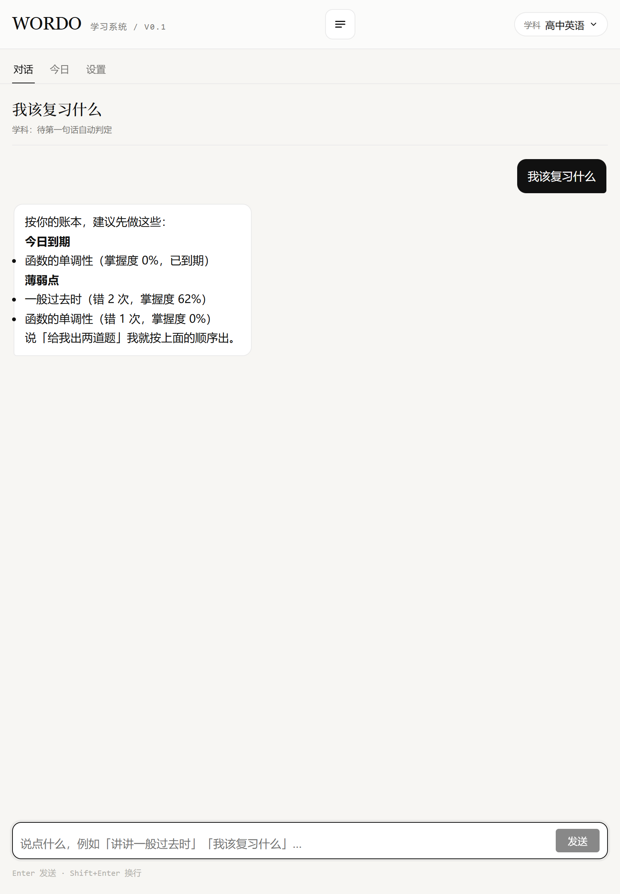
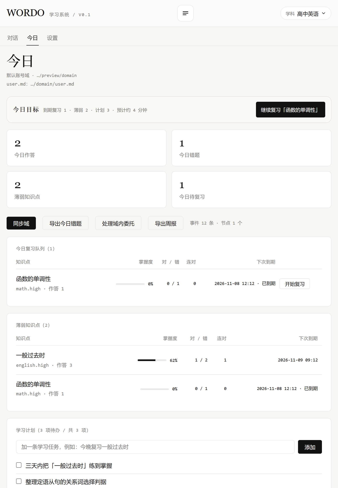
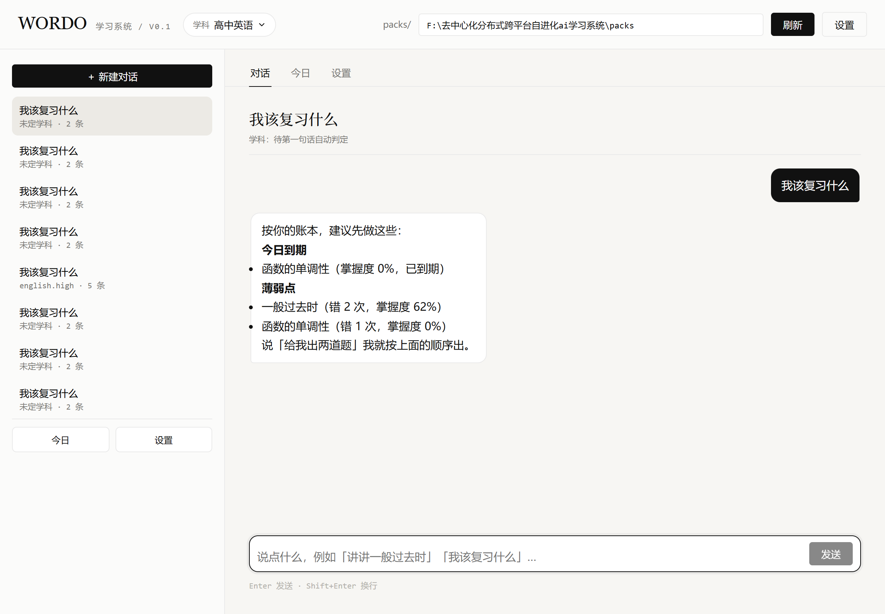

# iPad 试跑说明（无 Mac 条件下怎么看效果）

> 结论先说：**在 Windows 上无法编译出原生 iOS/Tauri 应用**（Tauri 2 iOS 目标需要 macOS + Xcode；
> iPad 越狱给的是「安装/运行自由」，**不提供 Apple 编译工具链**）。但要看 iPad 上的真实效果，有一条
> 立刻可用的路径：**把这套真实前端 + 真实后端跑在局域网，用 iPad 的 Safari 打开，并可「添加到主屏幕」当 App 用。**

---

## 方案 A（推荐，最快）：局域网预览 + 加到主屏幕

1. 保持这台电脑上的预览服务运行（默认端口 4310，监听所有网卡）：
   ```powershell
   cd tools/preview
   node server.mjs --port 4310 --packs <仓库>/packs --domain <仓库>/tools/preview/domain
   ```
2. 让 iPad 与这台电脑连**同一个 Wi-Fi**。
3. iPad Safari 打开：`http://<本机局域网IP>:4310/`（本机当前为 `http://10.1.20.182:4310/`，IP 可能变，用 `ipconfig` 确认）。
4. Safari 分享 → **添加到主屏幕** → 以全屏 standalone 方式启动（`manifest.webmanifest` + `apple-mobile-web-app-capable` 已内置）。
5. 需要模型能力（讲解/出题/判分）时：模型请求由**这台电脑**经 magpie 网关代为调用，iPad 只管显示。

### 可能卡住的两点
- **Windows 防火墙**：所有配置文件均开启，入站 4310 可能被拦。需要以管理员放行（示例）：
  `netsh advfirewall firewall add rule name="WORDO 4310" dir=in action=allow protocol=TCP localport=4310`
  （当前会话无管理员权限，未能自动添加。）
- **网络隔离**：公司/校园网常开「客户端隔离」，设备之间互相访问不到；换手机热点或家用 Wi-Fi 即可。

---

## 方案 B：离线静态演示（不依赖模型，只演示 UI/布局）
若只想看界面与交互骨架、不想走模型：可用 `tools/preview` 的 Node 后端（`--domain` 指向演示域）即可，
大部分页面（今日/薄弱/队列/计划/user.md/设置/新建学科）**不调模型**就能看；讲解/出题才需要网关。

---

## 方案 C：真要产出原生 `.ipa`
需要一台 Mac（或云 macOS）：
- 步骤见 [`apps/mobile/README.md`](../apps/mobile/README.md) 与 [`docs/多端构建指南.md`](多端构建指南.md)：`npx tauri ios init / dev / build`。
- 越狱 iPad 可安装**自签名/未签名**包（无需 App Store），但仍需 Mac 产出二进制。
- 前端已针对 iPad 断点做过适配（见下）。

---

## 本轮已验证（iPad 尺寸渲染，真前端 + 真后端）
- iPad 竖屏 `820×1180`、iPad Pro 竖屏 `1024×1366`、iPad 横屏 `1180×820`：**无横向溢出、无控制台报错**。
- 发现并修复：平板竖屏（641–900）会露出桌面用的 `packs\…` 路径框 → 已在该断点隐藏（改用顶部页签 + ☰ 抽屉）。
- 今日页「今日目标 / 预计分钟 / 继续复习」概览条在 iPad 上正常显示。

预览截图（脚本按 iPad 真实尺寸渲染）：
- 
- 
- 

> 注：截图里的对话记录重复是演示域被反复测试产生的脏数据，不代表产品问题。

---

## 待你确认
1. iPadOS 版本？是否与这台电脑**同一 Wi-Fi**？（决定方案 A 能否直连）
2. 是否要我把「纯前端静态演示包」打出来（可放到任意 http/本地，完全不依赖模型）？
3. 是否有 Mac/云 macOS？有的话我可以给出完整 **Tauri iOS 打包 + 越狱自签名安装**的逐步清单。
