# 03 · 跨平台运行时 + P2P 网络/同步 + 去中心化算力与存储

> **文档定位**：立项前资料收集 · 领域切片 3/？  
> **调研方法**：`web_search` 多轮交叉检索 + `web_fetch` 打开原文核实；优先引用官方文档 / 仓库 / 学术论文 / 官方定价页。  
> **可信度标注**：`✅ 一手`（官方文档、仓库、论文、官方定价页） · `⚠️ 二手`（第三方汇总、博客转述，数字需在立项前复核） · `❓ 待核实`（多源冲突或无法打开原文）  
> **调研日期**：2026-10-26  
> **范围界定**：只覆盖「运行时 + 网络 + 同步 + 存储/算力 + 安全」；自进化算法本体、联邦学习收敛性、模型训练方法学不在本文范围。

---

## ① 一句话结论

**技术上「端侧推理 + P2P 同步 + 去中心化存储」三段都已各自可用，但没有任何一个现成栈能同时满足「五端常驻 + 可验证算力 + 无中心依赖」——真正的硬约束不是算力也不是模型，而是①移动端操作系统禁止长期后台常驻（Android 15/16 前台服务 6h/24h 配额、iOS BGTaskScheduler 只有几十秒）、②NAT 打洞在真实互联网只剩约 70% 成功率且剩余 30% 必须回退中继（中继即中心化风险点）、③家用上行带宽（美国中位数约 25 Mbps）使真正的分布式训练不可行。**  
因此本项目应定位为：**「本地优先（local-first）+ P2P 同步 + 去中心化存储」为主干，端侧推理为执行器，去中心化算力只做「可选批处理卸载」而非训练主干；必须自带可自托管的中继/信令退路，并把移动端当作「弱常驻、可中断」的一等公民来设计。**

---

## ② 技术选型表

### 2.1 三端推荐总表

| 维度 | 桌面端（Win/macOS/Linux） | 移动端（Android/iOS） | 浏览器端 | 选择理由 | 替代方案 |
|---|---|---|---|---|---|
| **应用外壳** | **Tauri 2**（Rust + 系统 WebView） | **Tauri 2 移动端** 或 **Flutter** | 纯 Web 应用（PWA + WebGPU） | Tauri 2 打包 2.5–10 MB（Electron 80–150 MB），同一 Rust 核心可出桌面 + iOS/Android，`deny-by-default` 文件权限；P2P/加密/存储逻辑能用 Rust 写一份五端复用 ⚠️[dsh ref](https://github.com/jwynia/agent-skills/blob/main/skills/tech/development/tooling/electron-best-practices/references/tooling/tauri-comparison.md) | Electron（体积大、无移动端）；Flutter（UI 一致性最好但引入 Dart 生态、Rust FFI 需手写）；KMP（共享业务逻辑但 UI 仍需两端各写） |
| **端侧推理** | **llama.cpp / llama-server（GGUF）** | **llama.cpp（CPU/GPU）**，NPU 路线用 **ONNX Runtime + QNN** 或 **ExecuTorch** | **WebLLM / Transformers.js（WebGPU）** | GGUF 是唯一「一份量化文件跑遍 Win/macOS/Linux/Android」的格式；llama.cpp 为 MIT 且更新极快（2026-07 已到 b10068）✅[MSYS2 包信息](https://packages.msys2.org/packages/mingw-w64-x86_64-llama.cpp) | Apple 平台可换 **MLX**（Metal 原生、吞吐更高）；NPU 优先场景用 QNN/ExecuTorch；服务端对照 vLLM/SGLang |
| **P2P 传输** | **iroh（QUIC + 打洞）** 或 **libp2p** | **iroh / WebRTC 数据通道**（移动端不能做 DHT 长期承载） | **WebRTC 数据通道**（浏览器无法开 UDP socket） | iroh 1.0 已发布、双许可 MIT/Apache-2.0、自带打洞与 relay 回退，API 比 libp2p 简单得多 ✅[iroh README](https://raw.githubusercontent.com/n0-computer/iroh/0c17958dbc88e2b2ea81cca49119d541045630ef/README.md)、⚠️[heise 报道 Iroh 1.0](https://www.heise.de/en/news/Iroh-1-0-turns-the-internet-into-a-secure-localhost-11337046.html) | libp2p（生态最大、以太坊/IPFS 验证过，但复杂度高、需自己运维 relay）；Hyperswarm/HyperDHT（无服务器、但打洞鲁棒性口碑差 ⚠️[HN 讨论](https://news.ycombinator.com/item?id=25414038)） |
| **覆盖网兜底** | **Tailscale / WireGuard**（自建 Headscale） | 同上（移动客户端成熟） | 不适用 | 打洞失败时的可靠退路；Tailscale 官方称直连成功率「远高于 90%」✅[Tailscale 官方博客](https://tailscale.com/blog/nat-traversal-improvements-pt-1) | 自建 Headscale + DERP 中继；或直接自建 TURN |
| **本地优先数据层** | **Yjs（生态最广）** 或 **Loro（性能/体积）** + SQLite | 同左（SQLite 内置） | 同左（IndexedDB/OPFS 持久化） | 三者均 MIT 许可、生产验证；Yjs 绑定生态最深（ProseMirror/CodeMirror），Loro 双许可 MIT OR Apache-2.0 且已进 CRDT 性能第一梯队 ⚠️[pkgpulse 对比](https://www.pkgpulse.com/guides/yjs-vs-automerge-vs-loro-crdt-libraries-2026)、⚠️[hivebook](https://hivebook.wiki/wiki/loro-high-performance-crdt-library-for-local-first-apps) | Automerge（完整 Git-like DAG 历史，体积/内存开销更大）；CR-SQLite（已停摆）；ElectricSQL/PowerSync（服务端权威，与「去中心化」目标冲突） |
| **去中心化存储** | **本地磁盘 + IPFS/Kubo（自建）** | 只做缓存，不承担存储 | 只做缓存 | IPFS 平均检索延迟约 210 ms、集成简单 ⚠️[Garuda 论文页](https://garuda.kemdiktisaintek.go.id/documents/detail/5369710)；可在自有 DHT 上跑 | Storj（$4/TB/月，最便宜且 S3 兼容）、Filecoin（长期归档）、Arweave（一次性永久存，前置成本高） |
| **算力卸载** | **本地优先；批量任务卸载到 Akash / io.net** | 不参与 | 不参与 | io.net 上 H100 80GB 约 $1.80–4/小时，对比 Azure $6.98/小时、AWS $6.88/小时 ⚠️[io.net 定价指南](https://io.net/p/gpu-cloud-pricing-guide-2026-every-provider-compared) | Nosana（RTX 3060 约 $0.048/小时，最便宜但卡弱）⚠️[Nosana GPU Markets](https://learn.nosana.com/deployments/gpu-markets.html)；Render/Golem 待核实 |

### 2.2 关键取舍说明

1. **外壳层的核心矛盾不是 UI，而是「后台生存权」。** Tauri 有第三方插件把 Android 前台服务与 iOS BGTaskScheduler 包起来（⚠️[tauri-plugin-background-service](https://docs.rs/tauri-plugin-background-service/latest/tauri_plugin_background_service/)），但它无法绕过系统配额，只是把「怎么申请配额」标准化。
2. **P2P 层的核心矛盾是「无中心 vs 30% 失败率」。** 见 ④.3：DCUtR 打洞成功率 70%±7.1%，剩下 30% 只能靠中继；任何声称「完全无服务器」的方案在工程上都是把中继藏起来了。本项目应显式设计「可自托管中继池」。
3. **数据层的核心矛盾是「离线冲突合并 vs 文档膨胀」。** CRDT 能完美离线合并，但元数据增长是公认代价（⚠️[坦佩雷大学论文](https://trepo.tuni.fi/bitstream/handle/10024/237992/ShiferawErmyas.pdf)）。
4. **推理层的核心矛盾是「精度 vs 内存」。** Q4_K_M 相对 FP16 困惑度上升约 1.68%（4.1 GB / 7B 模型），Q8_0 仅 +0.03% 但要 7.0 GB —— 移动端实际只有 Q4 一档可用。

---

## ③ 关键项目表

### 3.1 端侧推理运行时

| 名称 | 仓库 / 官网 | 语言 | 许可 | 平台支持 | 评估 |
|---|---|---|---|---|---|
| llama.cpp | [github.com/ggml-org/llama.cpp](https://github.com/ggml-org/llama.cpp) | C/C++ | MIT ✅[来源](https://packages.msys2.org/packages/mingw-w64-x86_64-llama.cpp) | Win/macOS/Linux/Android/iOS（CPU+Metal+CUDA+Vulkan，部分 NPU 后端） | **本项目首选**。GGUF 事实标准、量化档位最全、社区最活跃；版本 1~b10068（2026-07-21 打包） |
| Ollama | [ollama.com](https://ollama.com) | Go + C++ | MIT ✅[来源](https://docs.openwebui.com/alternatives/ollama/) | macOS/Linux/Windows(含 WSL2)；Docker 需 nvidia-container-toolkit ✅[FAQ](https://mintlify.wiki/ollama/ollama/faq) | 开发体验最好，但**是守护进程 + HTTP API 形态**，不适合嵌进 Tauri 发行包；本地开发/对照用 |
| LM Studio | [lmstudio.ai](https://lmstudio.ai) | 闭源 | 专有（2025-07 起个人与公司均免费）⚠️[官方博客](https://lmstudio.ai/blog/free-for-work) | Win/macOS/Linux | GUI 工具，不是库；不能集成，只能做人工验证 |
| MLX | [github.com/ml-explore/mlx](https://github.com/ml-explore/mlx) | C++/Swift/Python | MIT ✅（Apple 官方） | Apple Silicon（macOS/iOS） | macOS 端吞吐与统一内存利用最好；Apple 官方研究显示 Mac Studio M5 Ultra 比 M3 Ultra 生成速度 1.6×，且吞吐**受内存带宽约束** ✅[Apple ML Research](https://machinelearning.apple.com/research/mlx-distributed-inference) |
| ONNX Runtime | [onnxruntime.ai](https://onnxruntime.ai) | C++ | MIT | Win(DirectML)/macOS(CoreML)/Android(NNAPI)/QNN/OpenVINO/Vitis-AI/XNNPACK ✅[OrtProvider 枚举](https://onnxruntime.ai/docs/api/java/ai/onnxruntime/OrtProvider.html) | **唯一能一网打尽各家 NPU 的运行时**；平台矩阵最广（官方文档逐项列出 CoreML / DirectML / NNAPI / QNN / ACL / CANN / RKNPU / TVM） |
| ExecuTorch | [github.com/pytorch/executorch](https://github.com/pytorch/executorch) | C++/Python | BSD-3（PyTorch 系） | iOS/Android/嵌入式/PC；CPU/GPU/NPU ✅[InfoWorld](https://www.infoworld.com/article/4079663/meta-releases-pytorch-inference-framework-for-edge-devices.html) | 1.0 已发布，PyTorch 生态导出链路最顺；LLM 支持仍在追赶 llama.cpp |
| MLC-LLM | [github.com/mlc-ai/mlc-llm](https://github.com/mlc-ai/mlc-llm) | C++/Python/TVM | Apache-2.0 | CUDA / Vulkan / Metal / WebGPU；iOS/Android ✅[README](https://raw.githubusercontent.com/xuvw/mlc-llm/refs/heads/main/README.md) | 编译式路线，跨后端最统一；工程复杂度与 TVM 学习曲线高 |
| WebLLM | [github.com/mlc-ai/web-llm](https://github.com/mlc-ai/web-llm) | TypeScript | Apache-2.0 | 浏览器（WebGPU） | 浏览器端最成熟；3B–4B 模型在高端独显上可达 60–90+ tok/s（⚠️原文明确「90 tok/s 是上界」）[来源](https://github.com/localmode-ai/localmode/blob/3c11b4e96324ab5c37db807ced1788c39ece6bf1/apps/docs/content/blog/webgpu-webllm-browser-llm.mdx) |
| Transformers.js | [github.com/huggingface/transformers.js](https://github.com/huggingface/transformers.js) | JS | Apache-2.0 | 浏览器（WASM + WebGPU，经 ONNX Runtime Web） | 200+ 模型即插即用；非 LLM 专用，大模型性能不如 WebLLM |
| vLLM | [github.com/vllm-project/vllm](https://github.com/vllm-project/vllm) | Python/C++ | Apache-2.0 | Linux + NVIDIA/AMD | **服务端对照**。PagedAttention 事实标准；机密 GPU 场景下离线吞吐开销 1–13% ✅[ISPASS 2026 论文](https://www.computer.org/csdl/proceedings-article/ispass/2026/510300a311/2gNOUa6Y1Ec) |
| SGLang | [github.com/sgl-project/sglang](https://github.com/sgl-project/sglang) | Python | Apache-2.0 | Linux + NVIDIA/AMD | 对照项。同条件测得 16,215 tok/s（SGLang）vs 16,132 tok/s（LMDeploy），资源利用率比标准部署高约 45% ⚠️[aimultiple 汇总](https://aimultiple.com/inference-engines)；但同论文测得其机密 GPU 开销 3–66%（常 >20%）✅[同上](https://www.computer.org/csdl/proceedings-article/ispass/2026/510300a311/2gNOUa6Y1Ec) |

### 3.2 跨平台应用外壳

| 名称 | 仓库 / 官网 | 语言 | 许可 | 平台支持 | 评估 |
|---|---|---|---|---|---|
| Tauri 2 | [tauri.app](https://tauri.app) | Rust + Web 前端 | MIT / Apache-2.0 ✅ | Win/macOS/Linux/**iOS/Android**（2024-10 起稳定）⚠️[来源](https://github.com/naveedharri/baalda/blob/e69a996695334a55f5ac36ef8d41b24e2ace99b6/docs/specs/01-desktop-app.md) | **首选**：2.5–10 MB 包体、~30–40 MB 空闲内存（Electron ~150 MB / ~250 MB）、deny-by-default 权限 ✅/⚠️[对比表](https://github.com/jwynia/agent-skills/blob/main/skills/tech/development/tooling/electron-best-practices/references/tooling/tauri-comparison.md) |
| Flutter | [flutter.dev](https://flutter.dev) | Dart | BSD-3-Clause | 全平台（六端） | UI 一致性最强、移动端最成熟；代价是 Dart 生态 + Rust FFI 需手工桥接；包体基线约 12–20 MB ⚠️[对照表](https://raw.githubusercontent.com/vasilyu1983/AI-Agents-public/3424d6f5e94010409da012eeb1cb84aaecec88b3/frameworks/shared-skills/skills/software-mobile/references/cross-platform-comparison.md) |
| React Native / Expo | [reactnative.dev](https://reactnative.dev) | JS/TS | MIT | iOS/Android（Web 需 react-native-web） | 生态与招人最容易；无桌面端原生支持；包体约 8–15 MB ⚠️[同上](https://raw.githubusercontent.com/vasilyu1983/AI-Agents-public/3424d6f5e94010409da012eeb1cb84aaecec88b3/frameworks/shared-skills/skills/software-mobile/references/cross-platform-comparison.md) |
| Kotlin Multiplatform | [kotlinlang.org/multiplatform](https://kotlinlang.org/docs/multiplatform.html) | Kotlin | Apache-2.0 | Android/iOS/桌面/后端（iOS 支持已 Stable）⚠️[KMP is Stable](https://book.kotlincn.net/kotlincn-docs.pdf) | 共享业务逻辑、UI 各写各的；JVM 生态强但 Rust 侧互操作成本高 |
| .NET MAUI | [dotnet.microsoft.com/apps/maui](https://dotnet.microsoft.com/apps/maui) | C# | MIT | iOS/Android/macOS/Windows | 微软生态内最顺；Linux 无官方支持，与本项目「五端」目标不符 |
| Electron | [electronjs.org](https://www.electronjs.org) | JS/TS | MIT | Win/macOS/Linux（**无移动端**） | 仅作反面参照：80–150 MB 体积、无移动端，直接出局 |

### 3.3 P2P 网络层

| 名称 | 仓库 / 官网 | 语言 | 许可 | 平台支持 | 评估 |
|---|---|---|---|---|---|
| libp2p | [libp2p.io](https://libp2p.io) | 多语言（Go/Rust/JS/nim） | 双 MIT/Apache-2.0 ✅[来源](https://pkg.go.dev/github.com/ipfs/kubo/core/node/libp2p?tab=licenses) | 桌面/移动/服务端 | 生态最大、被 IPFS 与以太坊验证；含 DHT(Kademlia)、GossipSub、Circuit Relay v2、DCUtR 打洞。复杂度高，运维 relay 是硬成本 |
| iroh | [iroh.computer](https://www.iroh.computer) | Rust | MIT / Apache-2.0 ✅[README](https://raw.githubusercontent.com/n0-computer/iroh/0c17958dbc88e2b2ea81cca49119d541045630ef/README.md) | 桌面/移动/服务端 | **推荐**。QUIC 原生、打洞失败自动走 relay 生态、1.0 已发布（2026-06）⚠️[heise](https://www.heise.de/en/news/Iroh-1-0-turns-the-internet-into-a-secure-localhost-11337046.html)；0.98.0 修复了网络切换后打洞重启 ⚠️[官方博客](https://www.iroh.computer/blog/iroh-0-98-0-getting-back-to-traversing-nats) |
| Hyperswarm / HyperDHT | [docs.pears.com](https://docs.pears.com/p2p/) | JS | MIT | Node/桌面 | 无服务器（Kademlia DHT 内建打洞）；但社区反馈打洞常失败、误报多 ⚠️[HN](https://news.ycombinator.com/item?id=25414038)；移动端不宜长期持有 DHT |
| Holepunch / Pear | [holepunch.to](https://holepunch.to) | JS | MIT | 桌面/移动 | 完整栈：Hypercore（签名追加日志）+ Corestore + Hyperswarm + Autobase ⚠️[综述](https://heart-it.github.io/react-brain/entries/p2p/)；偏「应用平台」，迁移成本高 |
| WebRTC 数据通道 | [W3C WebRTC](https://www.w3.org/TR/webrtc/) | JS/各端 | W3C 标准 | 浏览器 + 移动 + 桌面 | **浏览器端唯一现实选项**；但 ICE 依赖中心化 STUN/TURN + 信令，正是 DCUtR 论文指出的中心化弱点 ✅[DCUtR 论文](https://ar5iv.labs.arxiv.org/html/2510.27500) |
| Syncthing | [syncthing.net](https://syncthing.net) | Go | MPL-2.0（含多许可）✅[repology](https://repology.org/project/syncthing/information) | 全平台 | 成熟的文件同步（非 CRDT、非实时协作）；适合做「模型权重/数据集分发」通道，不适合做状态同步 |
| Tailscale / WireGuard | [tailscale.com](https://tailscale.com) | Go / Rust | BSD-3 / GPLv2 | 全平台 | 覆盖网兜底；直连成功率官方称「远高于 90%」，失败回落 DERP(HTTPS/443) ✅[官方博客](https://tailscale.com/blog/nat-traversal-improvements-pt-1)。闭源协调服务器 → 可自建 Headscale |
| GossipSub | [libp2p 规范](https://docs.libp2p.io/concepts/pubsub/overview/) | — | — | — | 广播/订阅层；大消息需要 stagger + fragmentation 优化，否则分发时延与带宽都会失控 ⚠️[arXiv 2504.10365](https://ar5iv.labs.arxiv.org/html/2504.10365) |

### 3.4 本地优先 / CRDT 同步

| 名称 | 仓库 / 官网 | 语言 | 许可 | 平台支持 | 评估 |
|---|---|---|---|---|---|
| Yjs | [github.com/yjs/yjs](https://github.com/yjs/yjs) | JS（yrs 为 Rust） | MIT ✅ | 浏览器/Node/移动（WASM） | **生态首选**：编辑器绑定最深、周下载约 92 万 ⚠️[pkgpulse](https://www.pkgpulse.com/guides/yjs-vs-automerge-vs-loro-crdt-libraries-2026)。注意墓碑内存泄漏问题 ✅[issue #741](https://github.com/yjs/yjs/issues/741) |
| Automerge | [automerge.org](https://automerge.org) | Rust/JS | MIT ✅ | 桌面/浏览器/移动 | 完整 Git-like DAG 历史，可回溯；体积与内存开销最大 |
| Loro | [loro.dev](https://loro.dev) | Rust/JS | MIT OR Apache-2.0 ✅[来源](https://hivebook.wiki/wiki/loro-high-performance-crdt-library-for-local-first-apps) | 桌面/浏览器/移动 | 新秀，性能与内存优化激进（官方 benchmark 见 ④.4）；生态比 Yjs 小 |
| Diamond Types | [github.com/josephg/diamond-types](https://github.com/josephg/diamond-types) | Rust | ISC ❓ | 全平台（库） | 学术级高性能文本 CRDT；生产成熟度待核实 |
| cr-sqlite | [github.com/vlcn-io/cr-sqlite](https://github.com/vlcn-io/cr-sqlite) | Rust/C | MIT/Apache-2.0 | 全平台 | **已停摆**（唯一尝试真正多主 SQLite↔SQLite CRDT 同步的项目）⚠️[Epicenter 综述](https://raw.githubusercontent.com/EpicenterHQ/epicenter/refs/heads/main/specs/20260417T140000-local-first-sqlite-sync-articles.md) |
| ElectricSQL 1.0 | [electric-sql.com](https://electric-sql.com) | Elixir/TS | Apache-2.0 | 桌面/浏览器/移动 | 定位已转向「Postgres 同步引擎 + shapes」，**服务端权威**，与去中心化目标部分冲突 ⚠️[同上](https://raw.githubusercontent.com/EpicenterHQ/epicenter/refs/heads/main/specs/20260417T140000-local-first-sqlite-sync-articles.md) |
| PowerSync | [powersync.com](https://www.powersync.com) | Dart/TS/Kotlin/Swift | FSL/商业 ❓ | 全平台 | 「服务端写、客户端读本地 SQLite」，双向但中心权威；许可需核实 |
| RxDB | [rxdb.info](https://rxdb.info) | TS | Apache-2.0 | 浏览器/Node/RN/Electron | 本地数据库 + 多后端复制（含 P2P/CouchDB）；适合作为「本地库」而非 CRDT |

### 3.5 去中心化存储与算力

| 名称 | 仓库 / 官网 | 语言 | 许可 | 平台支持 | 评估 |
|---|---|---|---|---|---|
| IPFS / Kubo | [ipfs.tech](https://ipfs.tech) | Go | MIT/Apache-2.0 | 全平台 | 内容寻址事实标准；平均检索延迟约 210 ms ⚠️[来源](https://garuda.kemdiktisaintek.go.id/documents/detail/5369710)；Optimistic Provide 把 PUT 做到亚秒级、网络开销降 >40% ✅[论文](https://lbnx03.ust.hk/ir/Record/1783.1-143002) |
| Filecoin | [filecoin.io](https://filecoin.io) | Go/Rust | MIT/Apache-2.0 | 服务端 | 冷存/归档；Synapse SDK 官方列价：存储 **$2.50/TiB/月**、CDN 出口 **$14/TiB**、每数据集最低 $0.06/月 ✅[Synapse 官方文档](https://github.com/FilOzone/synapse-sdk/blob/1b44e3f5/docs/src/content/docs/developer-guides/storage/storage-costs.mdx) |
| Arweave | [arweave.org](https://www.arweave.org) | Rust/Erlang | — | 服务端 | 一次性付费永久存储；单 GB 价格多源冲突：$7/GB ⚠️[dlt.sg](https://dlt.sg/decentralized-storage-networks-compared-ipfs-filecoin-arweave-and-emerging-alternatives/) vs 约 $24/GB ⚠️[blockchain.news](https://blockchain.news/zh/flashnews/%e6%b0%b8%e4%b9%85%e5%ad%98%e5%82%a8) → **❓待核实** |
| Storj | [storj.io](https://www.storj.io) | Go | Apache-2.0 | 全平台（S3 兼容） | **性价比最优**：$4/TB/月存储、$7/TB 出口，官方称比 AWS S3 便宜约 80% ⚠️[来源](https://rcloneview.com/support/blog/manage-storj-decentralized-cloud-sync-rcloneview) |
| Akash | [akash.network](https://akash.network) | Go | Apache-2.0 | Linux 容器 | 去中心化 K8s 风格算力；官方文档 A100 约 $0.50–1.50/小时、H100 约 $2.50–4.00/小时 ✅[官方文档](https://akash.network/docs/learn/core-concepts/gpu-deployments/)。营销页「H100 $1.33/hr vs AWS $3.93/hr」⚠️[官网](https://akash.network/meetingconfirmation/) 可信度低 |
| io.net | [io.net](https://io.net) | — | — | Linux 容器 | 聚合闲置 GPU；H100 80GB $1.80–4/小时，8 卡集群 $28–32/小时 vs Azure $91.44/小时，开通 <2 分钟 ⚠️[定价对比](https://io.net/p/rent-nvidia-gpus-for-ai-h100-a100-and-rtx-4090-pricing-comparison) |
| Nosana | [nosana.com](https://nosana.com) | — | — | Linux 容器（Solana 生态） | 便宜但卡弱：RTX 3060 约 $0.048/小时 ⚠️[官方 GPU Markets](https://learn.nosana.com/deployments/gpu-markets.html) |
| Gensyn | [gensyn.ai](https://www.gensyn.ai) | — | — | 分布式训练 | 验证层研究最扎实：Verde 协议 = 推荐委托 + 图定位 + 概率式 Proof-of-Learning + RepOps 可复现算子 ✅[Zenodo 技术分析](https://zenodo.org/records/17661576)、✅[官方研究博客](https://www.gensyn.ai/research/verde-verification-system-in-production) |
| Bittensor | [bittensor.com](https://bittensor.com) | Python/Rust | MIT | 分布式推理/训练 | 激励层成熟：2025-02 dTAO 升级、2025-12-13 首次减半；每个子网每块固定产出 1 α ✅[SEC 10-K](https://www.sec.gov/Archives/edgar/data/2029297/000119312526104209/tao-20251231.htm)、✅[taostats 文档](https://taostats.io/docs/concepts/how-emission-works/alpha-emission) |
| Render / Golem | [rendernetwork.com](https://rendernetwork.com) / [golem.network](https://www.golem.network) | — | — | Linux 容器 | 渲染/通用算力老玩家；**定价与验证机制 ❓待核实** |

### 3.6 安全与隐私工程

| 名称 | 规范 / 仓库 | 用途 | 关键事实 | 评估 |
|---|---|---|---|---|
| Noise 协议框架 | [libp2p/specs/noise](https://raw.githubusercontent.com/libp2p/specs/453552856aed903658d4611c905a9c885751cc84/noise/README.md) | 传输层加密握手 | libp2p 要求所有实现**必须**支持 `Noise_XX_25519_AESGCM_SHA256` ✅ | 直接复用，别自研 |
| Signal 双棘轮 | [IACR 2022 完整分析](https://crypto.iacr.org/2022/papers/530630_1_En_27_Chapter_OnlinePDF.pdf) | 端到端加密会话 | 外层公钥棘轮 + 内层对称棘轮；每条消息独立消息密钥 ✅ | 1:1 会话用双棘轮；群组需额外 Sender Keys/MLS |
| W3C DID | [DID Core](https://www.w3.org/TR/2020/WD-did-core-20201001/) | 节点身份 | DID 文档承载公钥，配合公私钥对签发 VC ✅ | 节点身份用「密钥对 + DID 文档」而非用户名 |
| WASM / WASI | [wasi.dev](https://wasi.dev) | 不可信代码沙箱 | 能力模型：模块只能访问显式授予的资源；无需启动内核 ✅[综述](https://cloud.tencent.com.cn/developer/article/2692721) | 端侧执行「第三方任务包」的首选：跨五端一致、毫秒级启动 |
| gVisor / Firecracker | [gvisor.dev](https://gvisor.dev) / [firecracker-microvm.github.io](https://firecracker-microvm.github.io) | 服务端强隔离 | gVisor 用户态内核 ~100 ms 启动、隔离较高；Firecracker 独立内核 microVM ✅[同上](https://cloud.tencent.com.cn/developer/article/2692721) | 只在服务端/桌面端的中继与算力节点上使用；移动端不可用 |
| Android 应用沙箱 | [developer.android.com](https://developer.android.com/guide/topics/manifest/manifest-intro) | 移动隔离 | 每应用独立 UID + SELinux；跨应用读内存需 root 或 debuggable ✅（平台事实） | 移动端天然沙箱；但反过来也意味着**无法做系统级常驻** |
| 供应链安全 | [XZ Utils CVE-2024-3094 分析](https://ieeexplore.ieee.org/document/11025592) | 依赖投毒 | 约 90% 现代应用含开源组件；攻击者渗透的是**开发流程**而非仅代码 ✅ | 必须锁依赖 + 可复现构建 + SBOM；P2P 场景下恶意节点还能投递恶意「任务包」，需签名校验 |

---

## ④ 关键技术数字

### 4.1 量化等级、体积与精度损失

| 量化 | 困惑度（FP16 基线 5.9566） | 相对损失 | 7B 模型体积 | 参考 tok/s | 来源 |
|---|---|---|---|---|---|
| Q8_0 | 5.9584 | **+0.03%** | 7.0 GB | 25 | ⚠️[llama.cpp 量化参考汇总](https://huggingface.co/buckets/merve/hermes-agent/tree/skills/mlops/inference/llama-cpp/references/quantization.md?code=true) |
| **Q4_K_M** | 6.0565 | **+1.68%** | 4.1 GB | 40 | ⚠️[同上](https://huggingface.co/buckets/merve/hermes-agent/tree/skills/mlops/inference/llama-cpp/references/quantization.md?code=true)（标注为 Recommended） |

> ⚠️ **注意**：上表来自社区汇总文档而非 llama.cpp 官方 benchmark 页，**具体数值立项前需用官方 `perplexity` 工具在目标模型上复测**；但「Q4_K_M 是体积/精度最优点、Q8_0 近乎无损」这一结论在多方资料中一致。  
> **工程含义**：7B 模型在 8 GB 内存手机上只有 Q4 一档可用（4.1 GB 权重 + KV cache + 运行时 ≈ 6–7 GB）；13B 以上在移动端基本不可行。

### 4.2 推理吞吐量级（需按硬件重新实测）

| 场景 | 数字 | 来源 |
|---|---|---|
| 浏览器 / WebGPU，3B–4B，高端独显 | 60–90+ tok/s（90 为**上界**） | ⚠️[WebLLM 实测博文](https://github.com/localmode-ai/localmode/blob/3c11b4e96324ab5c37db807ced1788c39ece6bf1/apps/docs/content/blog/webgpu-webllm-browser-llm.mdx) |
| 浏览器 / WebGPU，0.5B / 1.5B，RTX 5090 + Dawn，fp32 | 21.0 / 17.9 tok/s | ⚠️[WebGPU 调度开销论文](https://browse-export.arxiv.org/pdf/2604.02344) |
| Android NPU，Qwen3.5-4B，骁龙 8 Elite（S25） | 全速 NPU ~17.9 tok/s；MTP ~21.0；平衡 ~14.2 | ⚠️[Gitee 发布页](https://gitee.com/PocketOrca/pocket-orca-llm/releases/tag/v1.4.4) |
| Apple Silicon，MLX 分布式推理 | Mac Studio M5 Ultra 比 M3 Ultra 生成速度 1.6×，**吞吐受内存带宽约束** | ✅[Apple ML Research](https://machinelearning.apple.com/research/mlx-distributed-inference) |
| 服务端，SGLang / LMDeploy 汇总吞吐 | 16,215 / 16,132 tok/s | ⚠️[aimultiple 汇总](https://aimultiple.com/inference-engines) |
| 服务端，机密 GPU 场景离线吞吐开销 | vLLM 1–13%；SGLang 3–66%（常 >20%） | ✅[ISPASS 2026](https://www.computer.org/csdl/proceedings-article/ispass/2026/510300a311/2gNOUa6Y1Ec) |
| Snapdragon QNN 逐路径吞吐 | 见官方 benchmark 分档表（prefill 64→2048） | ✅[ailia LLM QNN Benchmark](https://docs.ailia.ai/en/llm/qnn-bench.html) |

### 4.3 NAT 穿透成功率（本项目最关键的一组数字）

| 指标 | 数值 | 来源 |
|---|---|---|
| DCUtR 打洞阶段成功率（**条件成功率**，前提：relay 预约 + 公网地址发现已成功） | **70% ± 7.1%** | ✅[ACM IMC 2026](https://dl.acm.org/doi/10.1145/3777912.3809138)、✅[arXiv 2510.27500](https://ar5iv.labs.arxiv.org/html/2510.27500) |
| 样本规模 | **440 万+ 次尝试，85,000+ 网络，167 个国家** | ✅[同上](https://ar5iv.labs.arxiv.org/html/2510.27500) |
| 首次尝试即成功比例 | **97.6%** | ✅[同上](https://ar5iv.labs.arxiv.org/html/2510.27500) |
| TCP vs QUIC | 统计上无差异（推翻「UDP 打洞更强」的行业口传） | ✅[同上](https://ar5iv.labs.arxiv.org/html/2510.27500) |
| 打洞协调开销 | 约 2 个往返、每方向 **<500 字节** 中继流量 | ✅[同上](https://ar5iv.labs.arxiv.org/html/2510.27500) |
| 失败面：EDM/symmetric NAT 占比 | 约 **30%**（Halkes 2011，样本 <2000，作者自认过时）；CGNAT 中 EDM 约占 **40%**（2016 数据） | ✅[同上](https://ar5iv.labs.arxiv.org/html/2510.27500) |
| Tailscale 直连成功率 | 内部指标「**远高于 90%**」，失败回落 DERP(HTTPS:443) | ✅[Tailscale 官方博客](https://tailscale.com/blog/nat-traversal-improvements-pt-1) |
| 「日蚀悖论」推进潜力 | 2048 端口探测 + 256 端口开放时，混合 EDM/EIM 组合成功率可达 64%；双 EDM 组合降至 0.01% | ✅[arXiv 2510.27500 §7.1](https://ar5iv.labs.arxiv.org/html/2510.27500) |

> **结论**：任何 P2P 设计都必须假设 **约 30% 的会话要长期走中继**。中继带宽成本与「是否自托管」是本项目必须提前立项的事。

### 4.4 CRDT 同步与冲突开销

Loro 官方 benchmark（N = 6000 客户端，JS/WASM）：

| 场景 | Yjs | Loro | Automerge | 来源 |
|---|---|---|---|---|
| B3.5 20√N 客户端并发插入文本 · updateSize | 48,129 B | — | — | ✅[loro.dev/docs/performance](https://loro.dev/docs/performance) |
| B3.5 同场景 · **docSize** | 24,313 B | 102,818 B（loro-old 48,053 B） | — | ✅[同上](https://loro.dev/docs/performance) |
| B3.5 同场景 · parseTime | 38 ms | 64 ms（loro-old 63 ms） | 67 ms（wasm 55 ms） | ✅[同上](https://loro.dev/docs/performance) |
| B4 真实编辑数据集 · docSize | 226,981 B | — | — | ✅[同上](https://loro.dev/docs/performance) |
| C1.1 并发插入+删除 100K · 耗时 | 27,138 ms | — | — | ✅[同上](https://loro.dev/docs/performance) |
| C1.2 并发写 Map 100K · docSize | 738,949 B | — | — | ✅[同上](https://loro.dev/docs/performance) |

> 说明：上表来自 Loro 自家 benchmark 页，**对 Yjs 未必最优配置**，仅用于「量级感知」：**10 万次操作级别下，CRDT 文档体积可达数百 KB ~ 1 MB，同步与解析耗时可达数十秒级**。  

其他关键事实：

- **Yjs 墓碑**：默认 `gc: true` 下墓碑只存元数据（开销很小）；`gc: false` 时每个墓碑约 **40 字节** ✅[Epicenter 分析](https://raw.githubusercontent.com/EpicenterHQ/epicenter/refs/heads/main/docs/articles/y-array-tombstones-are-tiny.md)。大量删除的 Map 场景存在内存泄漏，实测 `ydoc.destroy()` + 强制 GC 后仍驻留 **~4 GB** ✅[yjs issue #741](https://github.com/yjs/yjs/issues/741)。
- **架构结论**：CRDT 引擎在离线合并上「完美」，但**元数据膨胀与存储开销是固有代价**；关系型部分同步引擎则相反，牺牲离线合并换取数据完整性与后端安全 ⚠️[坦佩雷大学硕士论文](https://trepo.tuni.fi/bitstream/handle/10024/237992/ShiferawErmyas.pdf)。
- **冲突语义**：LWW（最后写入胜）、Add-Wins、Remove-Wins 等语义在 CRDT 综述中已形式化；选择取决于业务，不存在「通用正确」 ✅[CRDT: An Overview](https://ar5iv.labs.arxiv.org/html/1806.10254)。

### 4.5 存储与算力成本对照

| 项 | 数字 | 来源 |
|---|---|---|
| Storj 存储 | **$4 / TB / 月**；出口 **$7 / TB**（对比 Backblaze B2 $6/TB、Wasabi $7/TB） | ⚠️[RcloneView 对比](https://rcloneview.com/support/blog/manage-storj-decentralized-cloud-sync-rcloneview) |
| Filecoin（Synapse SDK） | 存储 **$2.50 / TiB / 月**；CDN 出口 **$14 / TiB**；最低 $0.06/月/数据集 | ✅[Synapse 官方文档](https://github.com/FilOzone/synapse-sdk/blob/1b44e3f5/docs/src/content/docs/developer-guides/storage/storage-costs.mdx) |
| Filecoin（另一口径） | 约 $200–1,000 / TB / 年 | ⚠️[Binance Square](https://www.binance.com/en-JP/square/post/29771856445553)（与上条冲突 → 以官方 SDK 为准） |
| Arweave | $7/GB（一次性）vs 约 $24/GB（一次性）→ **❓待核实** | ⚠️[dlt.sg](https://dlt.sg/decentralized-storage-networks-compared-ipfs-filecoin-arweave-and-emerging-alternatives/) / ⚠️[blockchain.news](https://blockchain.news/zh/flashnews/%e6%b0%b8%e4%b9%85%e5%ad%98%e5%82%a8) |
| IPFS 检索延迟 | 平均约 **210 ms**；Filecoin 数据可用性约 **99.9%** | ⚠️[Garuda 论文页](https://garuda.kemdiktisaintek.go.id/documents/detail/5369710) |
| io.net H100 80GB | **$1.80–4/小时**（Azure $6.98/小时、AWS $6.88/小时）；8 卡 $28–32/小时 vs Azure $91.44/小时 | ⚠️[io.net 定价指南](https://io.net/p/gpu-cloud-pricing-guide-2026-every-provider-compared) |
| Akash H100 80GB | **$2.50–4.00/小时**（官方文档口径） | ✅[Akash 官方文档](https://akash.network/docs/learn/core-concepts/gpu-deployments/) |
| Akash A100 | $0.50–1.50/小时 | ✅[同上](https://akash.network/docs/learn/core-concepts/gpu-deployments/) |
| Nosana RTX 3060 | **$0.048/小时** | ⚠️[Nosana GPU Markets](https://learn.nosana.com/deployments/gpu-markets.html) |
| 集中式云对照 | AWS H100 $6.88/小时；Azure $6.98/小时 | ⚠️[io.net](https://io.net/p/gpu-cloud-pricing-guide-2026-every-provider-compared) |

### 4.6 移动端后台与电量/流量的硬限制

| 平台 | 限制 | 数值 | 来源 |
|---|---|---|---|
| Android 15+ | `dataSync` / `mediaProcessing` 前台服务总运行时长 | **24 小时内合计 6 小时**，超时触发 `Service.onTimeout(int, int)` | ✅[Android 官方文档](https://developer.android.google.cn/develop/background-work/services/fgs/timeout) |
| Android 16 (API 36) | 前台服务启动的后台任务须遵守各自运行时配额 | — | ✅[Android 官方文档](https://developer.android.com/develop/background-work/services/fgs/changes) |
| Android 14/15/16 | Doze / App Standby 收紧；前台服务必须匹配允许类别，否则被拦截 | — | ⚠️[媒体综述](https://android-mt.ouest-france.fr/news/batterie-telephone-comment-optimiser-pour-une-autonomie-prolongee/190989/) |
| iOS | `BGAppRefreshTask` 约 **30 秒**；`BGProcessingTask` 约 **60 秒**（偶发 2–3 分钟）；**只有 background URLSession 能跑数小时** | — | ⚠️[native_workmanager 文档](https://github.com/brewkits/native_workmanager/blob/9d3f50e325662187390a2e044b04820aa206edb0/doc/IOS_BACKGROUND_LIMITS.md) |
| iOS | 用户可全局关闭「后台 App 刷新」；标准 BGTaskScheduler 与定时器在后台数分钟后被挂起 | — | ⚠️[Apple 开发者论坛](https://developer.apple.com/forums/tags/backgroundtasks?page=6&sortBy=activity&sortOrder=DESC) |
| Android 厂商 | MIUI 等定制 ROM 有额外后台清理策略 | — | ⚠️[flutter_background_service 文档](https://pub.dev/documentation/flutter_background_service/1.0.4/) |
| 移动 P2P 电量 | 维持 P2P 需持续收发管理数据；实测需主动规避 Doze 才能保持信息交换 | — | ⚠️[EApp 论文 PDF](http://www.cs.albany.edu/~mariya/lab/papers/eapp.pdf) |

### 4.7 网络工程现实（分布式训练为何不可行）

| 事实 | 数值 | 来源 |
|---|---|---|
| 家用上行带宽才是瓶颈（非算力） | 美国上行中位数约 **25 Mbps ≈ 3.1 MB/s**（FCC 2024），即使做 delta 压缩也受限 | ⚠️[《The Real Limits of Distributed LLM Training》](https://zenodo.org/records/20018909)（原文站点当时无法解析，数字取自检索摘要 → **建议立项时复核**） |
| 通信压缩能救回什么 | 通信高效模型并行方案可在 **80 Mbps 互联网级连接**下，逼近 100 Gbps 互连的集中式收敛表现 | ⚠️[Protocol Models, arXiv 2506.01260](http://www.arxiv.org/pdf/2506.01260) |
| DiStrO 类分布式优化器 | 每步通信相比 All-Reduce 降低 **857×** | ⚠️[Composer 复现框架](https://huggingface.co/Codeseys/composer-replication-framework/commit/7165832) |
| GossipSub 大消息 | 需 stagger + fragmentation 才能控制分发时延与带宽 | ⚠️[arXiv 2504.10365](https://ar5iv.labs.arxiv.org/html/2504.10365) |

---

## ⑤ 架构参考图

```mermaid
flowchart TB
    subgraph DEV["① 设备端（五端 + 浏览器）"]
        direction LR
        D1["Windows / macOS / Linux<br/>Tauri 2 桌面"]
        D2["Android / iOS<br/>Tauri 2 Mobile / Flutter"]
        D3["Browser<br/>PWA + WebGPU"]
    end

    subgraph RT["② 端侧推理运行时（执行器）"]
        direction LR
        R1["llama.cpp + GGUF<br/>Q4_K_M / Q8_0<br/>Win·macOS·Linux·Android·iOS"]
        R2["MLX (Apple Silicon)<br/>Metal 原生"]
        R3["ONNX Runtime<br/>QNN / NNAPI / CoreML / DirectML"]
        R4["WebLLM · Transformers.js<br/>WebGPU"]
    end

    subgraph DATA["③ 本地优先数据层（Local-First Core）"]
        direction LR
        S1["CRDT 文档<br/>Yjs / Loro / Automerge"]
        S2["本地 SQLite / OPFS<br/>索引·缓存·日志"]
        S3["模型与数据集缓存<br/>内容寻址 (CID)"]
    end

    subgraph NET["④ P2P 网络层"]
        direction TB
        N1["发现层<br/>Kademlia DHT · mDNS · GossipSub"]
        N2["连接层<br/>iroh QUIC / libp2p / WebRTC DataChannel"]
        N3["NAT 穿透<br/>DCUtR 打洞 ≈70% ｜ ICE/STUN"]
        N4["中继回退<br/>Circuit Relay v2 / DERP / 自建 Headscale-TURN<br/>⚠️ 约 30% 会话长期走这里"]
        N1 --> N2 --> N3
        N3 -->|成功 ~70%| N5["直连 P2P"]
        N3 -->|失败 ~30%| N4
    end

    subgraph STORE["⑤ 去中心化存储层"]
        direction LR
        P1["本地磁盘（主）"]
        P2["IPFS / Kubo<br/>热数据·内容寻址"]
        P3["Storj / Filecoin<br/>冷数据·归档"]
    end

    subgraph CLOUD["⑥ 可选云端兜底（不求去中心化，只求可用）"]
        direction LR
        C1["vLLM / SGLang<br/>大模型推理兜底"]
        C2["Akash / io.net / Nosana<br/>批量任务卸载"]
        C3["Gensyn Verde / Bittensor<br/>可验证算力（研究向）"]
    end

    subgraph SEC["⑦ 信任与安全（横切全栈）"]
        direction LR
        E1["传输加密<br/>Noise_XX_25519_AESGCM_SHA256"]
        E2["端到端会话<br/>Signal 双棘轮"]
        E3["节点身份<br/>密钥对 / W3C DID"]
        E4["执行沙箱<br/>WASM/WASI（端）<br/>gVisor / Firecracker（服务端）"]
        E5["供应链<br/>依赖锁定·SBOM·可复现构建·任务包签名"]
    end

    DEV --> RT
    DEV --> DATA
    RT -->|"产出/消费"| DATA
    DATA -->|"增量同步 (CRDT delta)"| NET
    NET -->|"内容分发 / 拉取"| STORE
    NET -.->|"大任务 / 重负载"| CLOUD
    STORE -.->|"冷热分层"| CLOUD
    SEC --- DEV
    SEC --- NET
    SEC --- CLOUD

    style N4 fill:#ffe0e0,stroke:#c00
    style N3 fill:#fff4d6,stroke:#c80
    style CLOUD fill:#e8f0ff,stroke:#48c
    style SEC fill:#f0f0f0,stroke:#888
```

**图示三条主线**：

1. **数据流（主）**：端侧推理产出 → CRDT 本地落盘 → P2P 增量同步 → 冷数据沉到 IPFS/Storj。
2. **退路（红）**：约 30% 的 P2P 会话打洞失败，必须有显式的中继层；中继是最容易重新引入中心化的地方，因此**中继必须可自托管、可多实例**。
3. **兜底（蓝）**：去中心化算力只承接「可离线、可重试、可验证」的批量任务，不承接实时推理与训练主干。

---

## ⑥ 坑与风险

### 6.1 移动端后台被杀 —— 本项目最大的架构性风险

- **Android**：`dataSync`/`mediaProcessing` 前台服务在 Android 15+ 被限制为 **24 小时内合计 6 小时**，超时触发 `onTimeout` 回调 ✅[官方文档](https://developer.android.google.cn/develop/background-work/services/fgs/timeout)；Android 16 进一步要求前台服务衍生的后台任务遵守各自配额 ✅[官方文档](https://developer.android.com/develop/background-work/services/fgs/changes)。厂商 ROM（MIUI 等）还有额外清理 ⚠️[flutter_background_service](https://pub.dev/documentation/flutter_background_service/1.0.4/)。
- **iOS**：`BGAppRefreshTask` 约 30 秒、`BGProcessingTask` 约 60 秒，且**用户可一键关闭后台刷新** ⚠️[native_workmanager](https://github.com/brewkits/native_workmanager/blob/9d3f50e325662187390a2e044b04820aa206edb0/doc/IOS_BACKGROUND_LIMITS.md)、⚠️[Apple 论坛](https://developer.apple.com/forums/tags/backgroundtasks?page=6&sortBy=activity&sortOrder=DESC)。
- **设计后果**：
  - 移动端**不能**被设计成可靠的 DHT 节点或长期在线的数据提供者（provider）；
  - 移动端只能做「**短连接 + 拉取式同步 + 后台 fetch 窗口内的小批量任务**」；
  - 必须有「**断点可恢复**」的任务模型（任务的中间态落盘，进程被杀后重启可续）。
- **反例警示**：维持 P2P 心跳需要持续收发管理数据，实测必须主动规避 Doze 才能保持信息交换，直接推高耗电 ⚠️[EApp 论文](http://www.cs.albany.edu/~mariya/lab/papers/eapp.pdf)。

### 6.2 P2P 打洞的 30% 失败面无法消除

- 集中式 CGNAT、企业防火墙、双层 NAT、封锁 UDP 的网络（如某些 UniFi 网关默认把 P2P 判定为威胁）都会让打洞直接失败 ✅[Tailscale](https://tailscale.com/blog/nat-traversal-improvements-pt-1)。
- 两个「硬 NAT」设备几乎必然需要中继 ✅[同上](https://tailscale.com/blog/nat-traversal-improvements-pt-1)。
- **风险**：中继一旦由单一实体运营，去中心化承诺立刻退化为「中心化 + 加密」；中继带宽成本随用户量线性增长。
- **缓解**：多中继池 + 任意公网节点可当 relay（libp2p Circuit v2 设计即为此，DCUtR 论文验证了成功率对 relay 特性不敏感 ✅[arXiv 2510.27500](https://ar5iv.labs.arxiv.org/html/2510.27500)）。

### 6.3 WebView 性能与一致性

- Tauri 在 Win（WebView2）与 macOS（WKWebView）**不是同一个引擎版本**，GPU/WebGPU 可用性、WASM 性能、内存表现都会分叉。
- 浏览器端 WebGPU 虽然四大浏览器均已支持（⚠️[报道](https://www.pcmarket.com.hk/webgpu-inow-supported-by-all-major-browsers/)），但 Safari 长期滞后（⚠️[caniuse](https://caniuse.com/webgpu)），且 **WebGPU 冷启动的主要延迟来自 shader 编译** ⚠️[SitePoint 实测](https://www.sitepoint.com/webgpu-vs-webasm-transformers-js/)。
- **风险**：若把推理放 WebView 里，会同时踩「引擎不一致 + WebGPU 缺失 + shader 编译卡顿」三个坑。
- **缓解**：推理下沉到 Rust 侧（llama.cpp 原生绑定），WebView 只做 UI；浏览器端作为**功能降级的只读/轻交互端**。

### 6.4 CRDT 文档膨胀与内存泄漏

- CRDT 的元数据增长是**结构性代价**，不是实现 bug ✅⚠️[坦佩雷大学论文](https://trepo.tuni.fi/bitstream/handle/10024/237992/ShiferawErmyas.pdf)。
- 实测量级：N=6000 并发场景下 docSize 从 24 KB（Yjs）到 738 KB（10 万次 Map 写入）不等；10 万次并发插入+删除耗时可达 27 秒 ✅[loro.dev benchmark](https://loro.dev/docs/performance)。
- Yjs 在大量删除的 Map 场景存在墓碑内存泄漏，`destroy()` 后仍驻留 ~4 GB ✅[issue #741](https://github.com/yjs/yjs/issues/741)。
- **风险**：模型权重、日志、对话历史若都塞进 CRDT，文档会迅速膨胀到不可同步。
- **缓解**：**只把「需要协作合并的小状态」放进 CRDT**；大对象走内容寻址存储（CID）只同步引用；定期做 snapshot + 截断历史。

### 6.5 去中心化存储的延迟与可用性

- IPFS 平均检索延迟约 210 ms，明显高于本地磁盘/中心化 CDN ⚠️[Garuda](https://garuda.kemdiktisaintek.go.id/documents/detail/5369710)；Filecoin 数据可用性约 99.9% ⚠️[同上](https://garuda.kemdiktisaintek.go.id/documents/detail/5369710)。
- 冷启动无缓存时模型权重（GB 级）从 IPFS 拉取是分钟级体验；Arweave 单 GB 价格高（$7–24/GB，❓口径冲突）。
- **缓解**：**本地磁盘为第一层存储**，IPFS/Storj 只做冷备与共享分发；关键权重打「预置包」随安装包分发。

### 6.6 分布式训练在家用网络下基本不可行

- 瓶颈是上行带宽（美国中位数 ~25 Mbps ≈ 3.1 MB/s）而非算力 ⚠️[Zenodo whitepaper](https://zenodo.org/records/20018909)。
- 学术方案（通信高效模型并行）在 80 Mbps 下可逼近 100 Gbps 集中式收敛 ⚠️[arXiv 2506.01260](http://www.arxiv.org/pdf/2506.01260)，但工程复杂度极高，且需要专门的压缩算子（如 DiStrO 每步通信降 857×）⚠️[Composer 复现框架](https://huggingface.co/Codeseys/composer-replication-framework/commit/7165832)。
- **结论**：「自进化」不应实现为「跨设备分布式梯度同步」，而应实现为**去中心化的经验/样本/权重增量交换**（类似 gossip + 定期合并），这才是家用网络能承受的形态。

### 6.7 安全与信任

- **供应链**：XZ Utils（CVE-2024-3094）显示攻击者渗透的是**开发流程**（社工、长期埋伏），而不只是代码；约 90% 现代应用含开源组件 ✅[MSR 2025 论文](https://ieeexplore.ieee.org/document/11025592)。
- **去中心化放大风险**：P2P 网络里「任务包/模型包」由陌生节点提供，**没有签名校验就等于远程代码执行**。
- **沙箱分层**：WASM/WASI 粒度最细、跨端最一致（毫秒级、能力模型）⚠️[综述](https://cloud.tencent.com.cn/developer/article/2692721)；gVisor/Firecracker 只在服务端可用；移动端无法部署 microVM。
- **TEE 的局限**：Gensyn 明确指出依赖 Intel SGX 类 TEE 的方案受硬件漏洞影响且可用性差 ⚠️[BlockMedia 报道](https://www.blockmedia.co.kr/archives/1010711)。
- **协议不要自研**：传输层直接用 `Noise_XX_25519_AESGCM_SHA256` ✅[libp2p 规范](https://raw.githubusercontent.com/libp2p/specs/453552856aed903658d4611c905a9c885751cc84/noise/README.md)，会话层直接用双棘轮 ✅[IACR 2022](https://crypto.iacr.org/2022/papers/530630_1_En_27_Chapter_OnlinePDF.pdf)。

### 6.8 许可与商用风险

- **风险项**：LM Studio 为专有软件（虽个人/工作均免费）⚠️[官方博客](https://lmstudio.ai/blog/free-for-work)；PowerSync 采用 FSL/商业条款 ❓；Arweave 部分组件许可未核实 ❓。
- **安全项**：llama.cpp（MIT）、Tauri 2（MIT/Apache-2.0）、iroh（MIT/Apache-2.0）、libp2p（MIT/Apache-2.0）、Yjs/Automerge（MIT）、Loro（MIT OR Apache-2.0）、Loro/ExecuTorch/MLC-LLM（Apache-2.0/BSD-3）均为宽松许可。
- **注意**：Syncthing 是 MPL-2.0 且二进制内含多个许可 ✅[repology](https://repology.org/project/syncthing/information)，若直接分发需保留许可声明。

---

## ⑦ 对本项目的 5 条可落地建议

### 建议 1：外壳选 Tauri 2，但**把推理与网络全部下沉到 Rust 层**，WebView 只做 UI

- **做法**：Rust 侧 = llama.cpp 绑定（`llama-cpp-2` 类）+ iroh + Yjs/Loro 的 Rust 实现（yrs / loro-rs）+ 本地 SQLite；WebView 只通过 `invoke` 调命令、拿事件。
- **理由**：Tauri 包体 2.5–10 MB、空闲内存 ~30–40 MB（对比 Electron ~150 MB/~250 MB）⚠️[对比表](https://github.com/jwynia/agent-skills/blob/main/skills/tech/development/tooling/electron-best-practices/references/tooling/tauri-comparison.md)；同时规避 6.3 的 WebView 引擎分叉问题（WebView2 vs WKWebView）。同一份 Rust 核心可编译到 iOS/Android，移动端不必重写。
- **验收动作**：立项后第一周做出「Tauri 2 五端 hello world + Rust 侧跑通 3B Q4_K_M 推理」的垂直切片。

### 建议 2：P2P 用 **iroh 为主 + libp2p 为备**，并**从第一天就设计自托管中继池**

- **做法**：连接层用 iroh（QUIC、MIT/Apache-2.0、自动 relay 回退）✅[README](https://raw.githubusercontent.com/n0-computer/iroh/0c17958dbc88e2b2ea81cca49119d541045630ef/README.md)；若需 DHT/GossipSub 生态则补 libp2p。中继层**不要依赖第三方公共 relay**：至少部署 3 个地理分散的自有 relay，并把「能否切换 relay 池」做成配置项。
- **理由**：DCUtR 实测打洞成功率 **70%±7.1%**，即约 30% 会话必然走中继 ✅[arXiv 2510.27500](https://ar5iv.labs.arxiv.org/html/2510.27500)；而打洞协调本身极轻（<500 字节/方向、2 RTT），**中继成本主要花在那 30% 的真实数据流上**，必须提前算带宽预算。
- **量化目标**：直连比例目标 >70%，中继流量占比目标 <30%；若实测中继占比 >50%，说明 NAT 环境比 IPFS 总体更差，需引入 Tailscale/Headscale 覆盖网兜底。

### 建议 3：数据层**严格分区**——CRDT 只装「小状态」，大对象走内容寻址

- **做法**：
  - CRDT（Yjs 或 Loro）只同步 **配置、任务元数据、经验条目索引、协作游标** 这类 KB 级状态；
  - 模型权重 / 数据集 / 大日志一律走 **CID + 本地磁盘**，CRDT 里只存 CID 与元信息；
  - 每月做一次 CRDT snapshot + 历史截断，避免文档膨胀（参见 4.4 的 738 KB/10 万次 MAP 写入量级）。
- **理由**：CRDT 元数据膨胀是结构性代价 ⚠️[坦佩雷大学论文](https://trepo.tuni.fi/bitstream/handle/10024/237992/ShiferawErmyas.pdf)；Yjs 墓碑泄漏实测可达 ~4 GB ✅[issue #741](https://github.com/yjs/yjs/issues/741)。
- **验收动作**：写一个「10 万次操作后 docSize / 解析耗时」的压测脚本作为回归门禁（阈值参考 4.4）。

### 建议 4：移动端定位为「**弱常驻参与者**」，不做 DHT/provider，任务模型必须可断点恢复

- **做法**：
  - 移动端**不承担**长期在线职责：不跑 DHT server、不做 relay、不做数据 provider；
  - 同步走「**拉取式 + 后台窗口内的小批量**」：Android 侧用前台服务（注意 6h/24h 配额）只覆盖「用户可见的活跃会话」，其余交给 WorkManager 类窗口任务；iOS 侧用 `BGProcessingTask`（~60 秒窗口）做一个批次的增量同步 ⚠️[限制来源](https://github.com/brewkits/native_workmanager/blob/9d3f50e325662187390a2e044b04820aa206edb0/doc/IOS_BACKGROUND_LIMITS.md)；
  - 所有任务状态落盘，进程被杀后重启可续；**移动端启动时先做一次完整一致性对账**（因为可能错过任意长度的广播）。
- **理由**：Android 15+ 前台服务 6h/24h 配额 ✅[官方文档](https://developer.android.google.cn/develop/background-work/services/fgs/timeout)、iOS 后台任务只有几十秒、且用户可整体关闭后台刷新 ⚠️[Apple 论坛](https://developer.apple.com/forums/tags/backgroundtasks?page=6&sortBy=activity&sortOrder=DESC)。把移动端当常驻节点是必翻车的设计。

### 建议 5：「自进化」实现为**去中心化的经验/增量交换**，而不是分布式梯度同步；算力外包只做可选批处理

- **做法**：
  - 主干：各端本地训练/微调（LoRA 级别）→ 产出**增量权重或经验数据** → 通过 P2P 广播 + CRDT 索引合并 → 定期在强节点上做合并；
  - 卸载：把**可重试、可验证**的批处理任务（如数据集清洗、批量评测、LoRA 训练）投到 Akash / io.net，H100 约 **$1.80–4/小时**（对比 AWS $6.88/小时），成本可控 ⚠️[io.net 定价指南](https://io.net/p/gpu-cloud-pricing-guide-2026-every-provider-compared)；
  - 验证：参考 Gensyn Verde 的「推荐委托 + 概率式 Proof-of-Learning + RepOps」思路 ✅[Zenodo](https://zenodo.org/records/17661576)，先做**抽样复算**这种工程上简单的乐观验证，再考虑 TEE（TEE 有硬件漏洞与可用性代价 ⚠️[报道](https://www.blockmedia.co.kr/archives/1010711)）。
- **理由**：家用上行带宽（中位数 ~25 Mbps）使真正的分布式训练不可行 ⚠️[Zenodo whitepaper](https://zenodo.org/records/20018909)；通信压缩方案（80 Mbps 逼近 100 Gbps 收敛）虽有论文支撑，但工程复杂度与验证成本远超立项期能力 ⚠️[arXiv 2506.01260](http://www.arxiv.org/pdf/2506.01260)。
- **风险控制**：所有来自陌生节点的权重/经验包必须**签名 + 沙箱加载 + 抽样复算**，否则等于开放 RCE（参见 6.7 与 XZ 案例 ✅[MSR 2025](https://ieeexplore.ieee.org/document/11025592)）。

---

## 附录 A：待核实清单（立项前必须补的一手数据）

| 项 | 现状 | 核实方式 |
|---|---|---|
| Q4_K_M / Q8_0 的困惑度与体积 | 来自社区汇总（⚠️二手） | 用 llama.cpp 官方 `perplexity` 在选定基座模型上自测 |
| 各端真实 tok/s | 全部来自第三方或旧硬件 | 在目标机型（含骁龙 8 系手机、Apple M 系、目标 Windows 笔记本）上跑统一 benchmark |
| Arweave 单 GB 价格 | $7 vs $24 两源冲突 | 查 [arweave.org](https://www.arweave.org) 官方计算器 |
| Render / Golem 定价与验证机制 | 未检索到一手数字 | 查官方文档 |
| PowerSync / Diamond Types 许可 | 未确认 | 查仓库 LICENSE |
| 分布式训练上行带宽中位数 | Zenodo 原文当时不可解析 | 复核原文与 FCC 2024 报告 |
| 各家用路由器 NAT 类型分布（当代） | 仅有 2011/2016 数据 | 自建探测节点采样（可选） |

## 附录 B：主要检索来源一览

**端侧推理**：[llama.cpp (MSYS2 包信息)](https://packages.msys2.org/packages/mingw-w64-x86_64-llama.cpp) · [GGUF 量化参考](https://huggingface.co/buckets/merve/hermes-agent/tree/skills/mlops/inference/llama-cpp/references/quantization.md?code=true) · [Ollama 许可](https://docs.openwebui.com/alternatives/ollama/) · [Ollama FAQ](https://mintlify.wiki/ollama/ollama/faq) · [LM Studio 免费](https://lmstudio.ai/blog/free-for-work) · [Apple MLX 分布式推理](https://machinelearning.apple.com/research/mlx-distributed-inference) · [ONNX Runtime EP 枚举](https://onnxruntime.ai/docs/api/java/ai/onnxruntime/OrtProvider.html) · [ExecuTorch 1.0](https://www.infoworld.com/article/4079663/meta-releases-pytorch-inference-framework-for-edge-devices.html) · [MLC-LLM README](https://raw.githubusercontent.com/xuvw/mlc-llm/refs/heads/main/README.md) · [WebLLM 实测](https://github.com/localmode-ai/localmode/blob/3c11b4e96324ab5c37db807ced1788c39ece6bf1/apps/docs/content/blog/webgpu-webllm-browser-llm.mdx) · [WebGPU 调度开销](https://browse-export.arxiv.org/pdf/2604.02344) · [vLLM/SGLang 汇总](https://aimultiple.com/inference-engines) · [机密 GPU 服务开销](https://www.computer.org/csdl/proceedings-article/ispass/2026/510300a311/2gNOUa6Y1Ec) · [aila QNN benchmark](https://docs.ailia.ai/en/llm/qnn-bench.html) · [骁龙 8 Elite 实测](https://gitee.com/PocketOrca/pocket-orca-llm/releases/tag/v1.4.4)

**应用外壳**：[Tauri vs Electron 对比](https://github.com/jwynia/agent-skills/blob/main/skills/tech/development/tooling/electron-best-practices/references/tooling/tauri-comparison.md) · [Tauri v2 选型记录](https://github.com/naveedharri/baalda/blob/e69a996695334a55f5ac36ef8d41b24e2ace99b6/docs/specs/01-desktop-app.md) · [跨平台体积对照](https://raw.githubusercontent.com/vasilyu1983/AI-Agents-public/3424d6f5e94010409da012eeb1cb84aaecec88b3/frameworks/shared-skills/skills/software-mobile/references/cross-platform-comparison.md) · [tauri-plugin-background-service](https://docs.rs/tauri-plugin-background-service/latest/tauri_plugin_background_service/) · [flutter_background_service](https://pub.dev/documentation/flutter_background_service/1.0.4/) · [KMP Stable](https://book.kotlincn.net/kotlincn-docs.pdf)

**P2P / NAT**：[DCUtR 大规模实测 (ACM IMC 2026)](https://dl.acm.org/doi/10.1145/3777912.3809138) · [DCUtR 全文 (arXiv 2510.27500)](https://ar5iv.labs.arxiv.org/html/2510.27500) · [Tailscale NAT 穿透改进](https://tailscale.com/blog/nat-traversal-improvements-pt-1) · [iroh 0.98.0](https://www.iroh.computer/blog/iroh-0-98-0-getting-back-to-traversing-nats) · [iroh README/许可](https://raw.githubusercontent.com/n0-computer/iroh/0c17958dbc88e2b2ea81cca49119d541045630ef/README.md) · [Iroh 1.0 报道](https://www.heise.de/en/news/Iroh-1-0-turns-the-internet-into-a-secure-localhost-11337046.html) · [libp2p 许可](https://pkg.go.dev/github.com/ipfs/kubo/core/node/libp2p?tab=licenses) · [Hyperswarm/HyperDHT](https://docs.pears.com/p2p/) · [Hyperswarm 打洞口碑](https://news.ycombinator.com/item?id=25414038) · [GossipSub 大消息](https://ar5iv.labs.arxiv.org/html/2504.10365) · [Syncthing 许可](https://repology.org/project/syncthing/information)

**Local-First / CRDT**：[Ink & Switch 七理想](https://signaldb.js.org/local-first/) · [Local-First 播客逐字稿](https://raw.githubusercontent.com/syntaxfm/website/refs/heads/main/shows/739%20-%20The%20LoFi%20Movement%20Building%20Local%20First%20Apps.md) · [Loro 官方 benchmark](https://loro.dev/docs/performance) · [Yjs/Automerge/Loro 对比](https://www.pkgpulse.com/guides/yjs-vs-automerge-vs-loro-crdt-libraries-2026) · [Loro 许可](https://hivebook.wiki/wiki/loro-high-performance-crdt-library-for-local-first-apps) · [Yjs 墓碑](https://raw.githubusercontent.com/EpicenterHQ/epicenter/refs/heads/main/docs/articles/y-array-tombstones-are-tiny.md) · [Yjs 墓碑泄漏 issue](https://github.com/yjs/yjs/issues/741) · [SQLite 同步引擎现状](https://raw.githubusercontent.com/EpicenterHQ/epicenter/refs/heads/main/specs/20260417T140000-local-first-sqlite-sync-articles.md) · [同步引擎学位论文](https://trepo.tuni.fi/bitstream/handle/10024/237992/ShiferawErmyas.pdf) · [CRDT 综述](https://ar5iv.labs.arxiv.org/html/1806.10254)

**存储与算力**：[去中心化存储对比](https://dlt.sg/decentralized-storage-networks-compared-ipfs-filecoin-arweave-and-emerging-alternatives/) · [Filecoin 官方定价 (Synapse)](https://github.com/FilOzone/synapse-sdk/blob/1b44e3f5/docs/src/content/docs/developer-guides/storage/storage-costs.mdx) · [Storj 对比](https://rcloneview.com/support/blog/manage-storj-decentralized-cloud-sync-rcloneview) · [IPFS/Filecoin 延迟与可用性](https://garuda.kemdiktisaintek.go.id/documents/detail/5369710) · [IPFS Optimistic Provide](https://lbnx03.ust.hk/ir/Record/1783.1-143002) · [io.net 定价指南](https://io.net/p/gpu-cloud-pricing-guide-2026-every-provider-compared) · [io.net H100 对比](https://io.net/p/rent-nvidia-gpus-for-ai-h100-a100-and-rtx-4090-pricing-comparison) · [Akash GPU 定价](https://akash.network/docs/learn/core-concepts/gpu-deployments/) · [Nosana GPU Markets](https://learn.nosana.com/deployments/gpu-markets.html) · [Gensyn Verde 分析](https://zenodo.org/records/17661576) · [Gensyn 官方研究](https://www.gensyn.ai/research/verde-verification-system-in-production) · [Bittensor 10-K](https://www.sec.gov/Archives/edgar/data/2029297/000119312526104209/tao-20251231.htm) · [Bittensor 排放](https://taostats.io/docs/concepts/how-emission-works/alpha-emission)

**安全与工程现实**：[libp2p Noise 规范](https://raw.githubusercontent.com/libp2p/specs/453552856aed903658d4611c905a9c885751cc84/noise/README.md) · [双棘轮完整分析](https://crypto.iacr.org/2022/papers/530630_1_En_27_Chapter_OnlinePDF.pdf) · [W3C DID Core](https://www.w3.org/TR/2020/WD-did-core-20201001/) · [沙箱方案综述](https://cloud.tencent.com.cn/developer/article/2692721) · [XZ 后门分析](https://ieeexplore.ieee.org/document/11025592) · [Android FGS 超时](https://developer.android.google.cn/develop/background-work/services/fgs/timeout) · [Android FGS 变更](https://developer.android.com/develop/background-work/services/fgs/changes) · [iOS 后台限制](https://github.com/brewkits/native_workmanager/blob/9d3f50e325662187390a2e044b04820aa206edb0/doc/IOS_BACKGROUND_LIMITS.md) · [Apple 论坛后台任务](https://developer.apple.com/forums/tags/backgroundtasks?page=6&sortBy=activity&sortOrder=DESC) · [家用上行瓶颈 whitepaper](https://zenodo.org/records/20018909) · [通信高效去中心化训练](http://www.arxiv.org/pdf/2506.01260) · [移动 P2P 功耗 (EApp)](http://www.cs.albany.edu/~mariya/lab/papers/eapp.pdf) · [WebGPU 支持情况](https://caniuse.com/webgpu) · [WebGPU 四浏览器支持](https://www.pcmarket.com.hk/webgpu-inow-supported-by-all-major-browsers/) · [Transformers.js/WebGPU 对比](https://www.sitepoint.com/webgpu-vs-webasm-transformers-js/)
